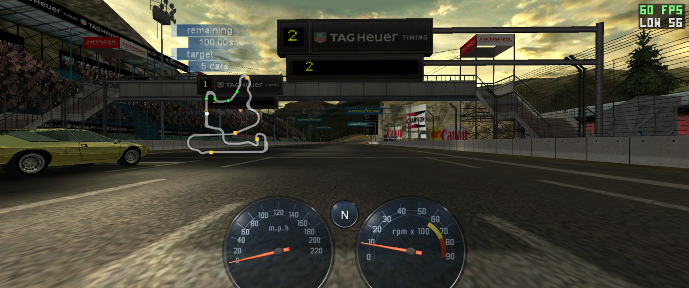
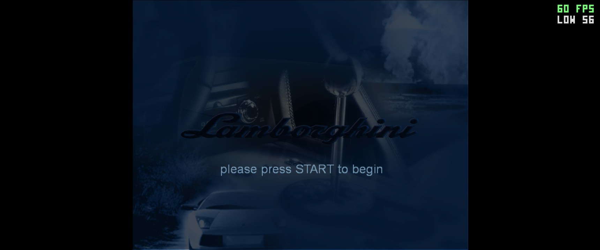
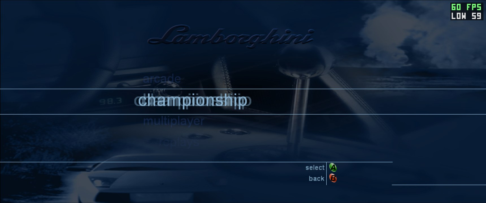
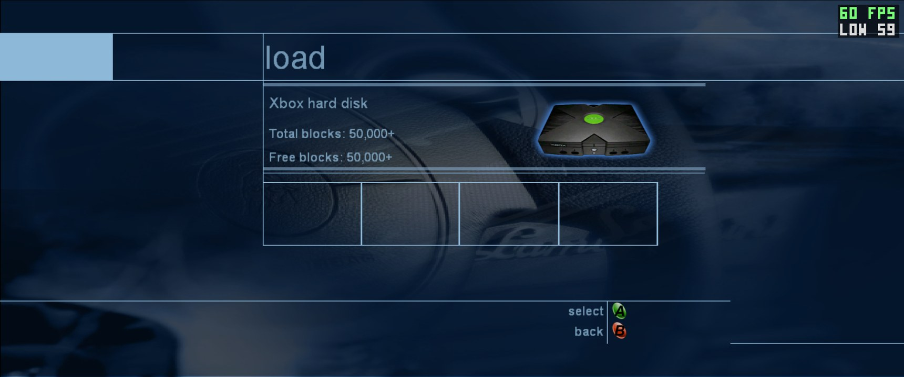
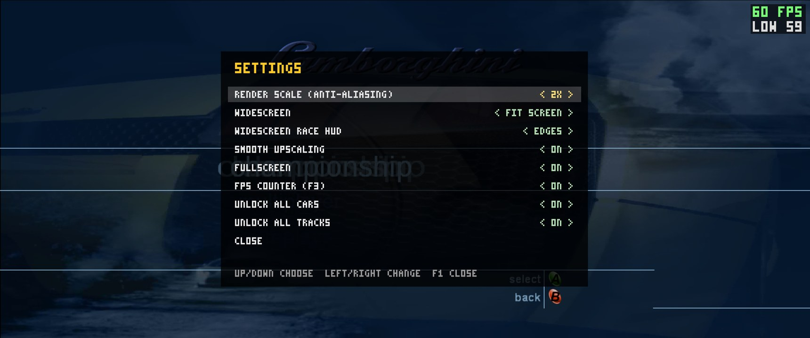

# Lamborghini — Xbox static recompilation for Linux and Windows

A native PC port (Linux, and Windows as an experimental build) of **Lamborghini**, Rage Software's unreleased original-Xbox racing game
(title ID 52410001, December 2002 pre-release build). It's built by *static recompilation*: the
game's x86 code is translated to C ahead of time with
[xboxrecomp](https://github.com/sp00nznet/xboxrecomp) and compiled into a normal Linux or Windows program,
running on an emulated Xbox kernel, GPU (NV2A → OpenGL) and audio (MCPX APU → SDL2).

> **No game files are included.** You need **your own copy** of the game: the disc image
> (`.iso`) or its extracted files. See [Getting the game files](#getting-the-game-files).

<p align="center">
  
</p>

| | |
|---|---|
|  |  |
| *Title screen (videos and stills stay 4:3)* | *Main menu, widescreen* |
|  |  |
| *Save game load screen* | *F1 settings menu* |

*Screenshots: 3440×1440 ultrawide, widescreen FIT SCREEN, F3 frame-rate counter on.*

## Contents

- [What works](#what-works)
- [Quick start](#quick-start)
- [Getting the game files](#getting-the-game-files)
- [Requirements](#requirements)
- [Controls](#controls)
- [Settings menu (F1)](#settings-menu-f1)
- [Saves, settings and logs](#saves-settings-and-logs)
- [Having problems? Post your log](#having-problems-post-your-log)
- [Known issues](#known-issues)
- [Building from source](#building-from-source)
- [Credits and license](#credits-and-license)

## What works

- The whole game: intro videos, menus, car select, championship, arcade, free run, time of day
  and weather, and 2–4 player split screen.
- 60 fps in races, locked to the console's 60 Hz like on hardware.
- GPU renderer (OpenGL 4.3) with render scale up to 4× (or AUTO to match your screen), plus true
  widescreen with an optional edge-anchored race HUD.
- Sound: music, engines, effects and 3D positional audio.
- Controllers (hot-plug, up to four) and keyboard.
- **Linux** (main platform) and **Windows** (new, experimental: tested under Wine with a real GPU
  at 60 fps with full sound, not yet on real Windows. Reports are very welcome!).

## Quick start

### Linux

1. Download `Lamborghini-recomp-<version>-linux-x86_64.zip` from
   [**Releases**](../../releases/latest) and extract it.
2. Extract your whole game ISO into the `Lamborghini` folder inside it
   ([how](#getting-the-game-files)):
   ```
   Lamborghini-recomp/
       Lamborghini.x86_64        <- run this
       Lamborghini/              <- extract your ISO in here
           default.xbe, *.xfs, Audio/, Foreign/, ...
   ```
3. Run `Lamborghini.x86_64` (double-click it, or `./Lamborghini.x86_64` in a terminal). If it
   won't start, make it executable first: `chmod +x Lamborghini.x86_64`.

### Windows (experimental)

1. Download `Lamborghini-recomp-<version>-windows-x64.zip` from
   [**Releases**](../../releases/latest) and **extract it** (don't run it from inside the zip).
2. Extract your whole game ISO into the `Lamborghini` folder inside it
   ([how](#getting-the-game-files)):
   ```
   Lamborghini-recomp\
       Lamborghini.exe           <- run this
       SDL2.dll, libepoxy-0.dll  <- keep these next to the exe
       Lamborghini\              <- extract your ISO in here
   ```
3. Double-click `Lamborghini.exe`. SmartScreen may say *"Windows protected your PC"* because
   the exe isn't signed: click **More info → Run anyway**.

## Getting the game files

**Extract your whole Lamborghini ISO into the `Lamborghini` folder.** That's all: the game
uses the disc's files as they are.

### XBLA Installer (easiest)

[**XBLA Installer**](https://github.com/trev82usa/XBLA-Installer) is our own extraction tool.
Despite the name, it opens **original Xbox ISOs** too, with no command line needed.

1. Download it from its [latest release](https://github.com/trev82usa/XBLA-Installer/releases/latest)
   (Linux: `XBLA-Installer-linux-x64.tar.gz`, extract and run `./XBLA-Installer`; Windows:
   `XBLA-Installer.exe`).
2. Under **Game package**, pick your Lamborghini `.iso`.
3. Tick **Just extract**.
4. Under **Install into**, pick the `Lamborghini` folder from this port's zip.
5. Press **Install**.

### extract-xiso (command line)

```sh
extract-xiso -d /path/to/Lamborghini-recomp/Lamborghini  Lamborghini.iso
```

Already have the disc's files extracted? Copy them all into the `Lamborghini` folder.

**Check:** `Lamborghini/default.xbe` must exist. If it ended up one folder deeper (e.g.
`Lamborghini/Lamborghini/default.xbe`), move everything up a level.

## Requirements

### Linux

- **64-bit Linux with glibc 2.34 or newer**: Ubuntu 22.04+, Debian 12+, Fedora 35+, Linux Mint
  21+, Pop!_OS 22.04+, current Arch/Manjaro/EndeavourOS, Steam Deck desktop mode.
- **A GPU with OpenGL 4.3**: any AMD or Intel GPU from the last decade with Mesa, or NVIDIA
  with its driver.
- **SDL2 and libepoxy**. Most desktops already have them. If the game says a library is
  missing:
  - Ubuntu/Debian/Mint: `sudo apt install libsdl2-2.0-0 libepoxy0`
  - Fedora: `sudo dnf install SDL2 libepoxy`
  - Arch/Manjaro: `sudo pacman -S sdl2 libepoxy`

### Windows

- **Windows 10 or 11, 64-bit.**
- **A GPU with OpenGL 4.3 and your GPU maker's driver** (AMD, NVIDIA or Intel; any card from the
  last ~10 years). The generic "Microsoft Basic Display Adapter" driver isn't enough.
- Nothing else to install: `SDL2.dll` and `libepoxy-0.dll` come in the zip.

## Controls

### Controllers

Any controller SDL recognises works: Xbox 360 / One / Series pads, PlayStation pads, 8BitDo,
Steam Deck and so on.

- **Plug and play.** Controllers can be connected or disconnected while the game runs. The log
  shows `[INPUT] controller ... connected`.
- **Multiplayer.** Each connected controller is another player. Connect 2, 3 or 4 pads for the
  game's split-screen modes. Four-player split screen runs at 30 fps, as on the Xbox.
- **Analog.** Sticks and triggers are fully analog (steering, throttle and brake).

| Your controller | Original Xbox pad |
|---|---|
| A / B / X / Y (PlayStation: ✕ ○ □ △) | A / B / X / Y |
| Left bumper (L1) | Black |
| Right bumper (R1) | White |
| Left / right trigger | Left / right trigger (analog) |
| Left / right stick, stick clicks | Left / right thumbstick, clicks |
| D-pad | D-pad |
| Start / Menu | Start |
| Back / View / Select | Back |

### Keyboard

The keyboard is player 1, alongside a controller if one's connected.

| Key | Xbox pad | Key | Xbox pad |
|---|---|---|---|
| Enter | Start | Backspace | Back |
| Z / X / C / V | A / B / X / Y | Q / E | White / Black |
| 1 / 3 | Left / right trigger | Arrow keys | D-pad |
| W A S D (or keypad 8 4 2 6) | Left stick | I J K L | Right stick |

**Racing on the keyboard:** **W** accelerates, **S** brakes, **A / D** steer and **V** looks
back. Steering eases in over about 0.3 s, so tap A/D for small corrections and hold for full
lock. (`RECOMP_KEYBOARD_RACING=0` gives instant full steering.)

### Hotkeys

| Key | Action |
|---|---|
| **F1** | Open/close the [settings menu](#settings-menu-f1) |
| **F3** | Frame-rate counter on/off |
| **F11** | Fullscreen on/off |

## Settings menu (F1)

Press **F1** at any time, even mid-race, to open the settings overlay. Use it with the
**keyboard**:

- **↑ / ↓** choose an option
- **← / →** (or Enter/Space) change it
- **F1** or **Esc** close the menu

The game gets no input while the menu is open. Every change applies **immediately**, with no
restart, and is saved straight away to `~/.config/xboxrecomp/settings.ini`.

| Option | Choices | What it does |
|---|---|---|
| **Render scale (anti-aliasing)** | AUTO, 1X (OFF), 2X, 3X, 4X | Draws the game at a multiple of the Xbox's 640×480 for a sharper, smoother picture. **AUTO** (default) renders at your window's or screen's height (2.25× on a 1080p screen, 3× on 1440p) and follows window resizes. Higher costs more GPU; 2× is nearly free on most cards. **1X** is the original resolution. |
| **Widescreen** | OFF (4:3), FIT SCREEN | **FIT SCREEN** fills your screen's width (16:9, 16:10, 21:9, …) with a genuinely wider view of the track, not a stretch. The HUD and menus keep their shape in the centre. Intro videos and loading screens stay 4:3 with black bars. **OFF** is the original 4:3 picture. |
| **Widescreen race HUD** | CENTRE, EDGES | Only matters with widescreen on. **CENTRE** keeps the race HUD (lap, position, time, map) in the middle 4:3 area as designed. **EDGES** moves its left and right parts out to the screen edges, so they cover less of the road. The mirror stays centred, and menus (including the pause menu) always stay centred. |
| **Smooth upscaling** | ON, OFF | How the picture is scaled to your window. **ON** is smooth (linear). **OFF** gives sharp, blocky pixels, which looks best at 1X for a retro look. |
| **Fullscreen** | ON, OFF | Borderless fullscreen at your desktop resolution. Same as **F11**. |
| **FPS counter (F3)** | ON, OFF | Top-right overlay: frames in the last second, and **LOW** (the slowest frame). Green = 60, yellow = 30–57, red = below 30. |
| **Unlock all cars** | ON, OFF | All cars available in every mode. |
| **Unlock all tracks** | ON, OFF | All ten tracks available, using the game's own unlock (the same as winning the championship). Saved into your profile. Night racing is offered in Free Run only, unlocked or not (as in the original game). |
| **Close** | | Closes the menu (as F1/Esc do). |

### Environment variables (optional)

Set these in a terminal before running, e.g. `RECOMP_WIDESCREEN=1 ./Lamborghini.x86_64`. They
override the saved settings for that run.

| Variable | Effect |
|---|---|
| `RECOMP_GL_SCALE=n` | Render scale, fractions allowed (e.g. `2.25`) |
| `RECOMP_WIDESCREEN=1` / `RECOMP_HUD_EDGES=1` | Widescreen / race HUD at the edges |
| `RECOMP_WINDOW_SCALE=n` | Starting window size, as a multiple of 640×480 |
| `RECOMP_FPS_OVERLAY=1` | Start with the frame-rate counter on |
| `RECOMP_KEYBOARD_RACING=0` | Plain keyboard mapping (instant full steering) |
| `RECOMP_GL=0` | CPU software renderer (very slow; used automatically without OpenGL 4.3) |
| `RECOMP_FLIP_PACING=0` | Uncap the frame rate (parts of the game then run too fast) |

[docs/DEVLOG.md](docs/DEVLOG.md) lists the developer and debugging switches.

## Saves, settings and logs

| What | Linux | Windows |
|---|---|---|
| Save game (profiles, unlocks, records) | `~/.local/share/xboxrecomp/` | `%LOCALAPPDATA%\xboxrecomp\` |
| Settings (F1 menu) | `~/.config/xboxrecomp/settings.ini` | `%LOCALAPPDATA%\xboxrecomp\settings.ini` |
| Log of the last run | `lamborghini_log.txt` next to the program | same |
| Kernel log of the last run | `xbox_kernel.log` next to the program | same |

The saves are kept outside the game folder, so you can move or update the game without losing
them. To start fresh, delete that save folder. (Windows: paste `%LOCALAPPDATA%\xboxrecomp`
into the Explorer address bar.)

## Having problems? Post your log

Please [open an issue](../../issues/new) and **attach `lamborghini_log.txt`** from the game
folder. The log is rewritten every time the game starts, so copy it **right after** the problem
happens, before running the game again. Without the log we can only guess.

Please include:

1. **`lamborghini_log.txt`** (drag the file into the issue). `xbox_kernel.log` helps too.
2. **What happened** and what you were doing (menu, track, car, time of day, weather,
   split-screen?).
3. **A screenshot or short video** for anything visual, and a clip for sound problems.
4. **Your system:** Linux distro or Windows version, GPU and driver version (Linux:
   `glxinfo -B | head -20`), and your F1 settings.
5. If it **crashed or won't start**: on Linux run it from a terminal (`./Lamborghini.x86_64`)
   and paste what's printed; on Windows, a screenshot of any error message.

**Common fixes first:**

| Problem | Fix |
|---|---|
| Nothing happens when double-clicked | `chmod +x Lamborghini.x86_64`, or run it from a terminal to see the error |
| `error while loading shared libraries: libSDL2…` / `libepoxy…` | Install SDL2 and libepoxy ([Requirements](#requirements)) |
| `GLIBC_2.34 not found` | Your distro is too old; Ubuntu 22.04 or newer is needed |
| A box says **"Game files not found"** | The ISO isn't extracted into the right place. `Lamborghini/default.xbe` must exist next to the program ([Getting the game files](#getting-the-game-files)) |
| Starts but stops at a disc error / missing sounds or videos | Some files are missing: extract the *whole* ISO again |
| Very slow (single-digit fps) | Your GPU or driver lacks OpenGL 4.3 and the game fell back to the CPU renderer; check the log for `[GL]` lines |
| Controller not working | Check the log for `[INPUT] controller ... connected`; try another USB port or Bluetooth re-pair |
| Windows: *"SDL2.dll / libepoxy-0.dll was not found"* | Keep both DLLs next to `Lamborghini.exe` (extract the whole zip) |
| Windows: antivirus removes the exe | A false positive (unsigned, unusual program): restore it / add an exception |

## Known issues

- **Night races:** thin light streaks on screen, and headlight pools on the road may not match
  the Xbox.
- **Road:** some dotted/patchy road textures at certain times of day.
- **Sound:** the tyre-skid sound can stutter.
- **Frame hitches:** occasional long frames, mostly at race start with the whole field in view.
- **Windows:** new and experimental; tested under Wine with a real GPU, not yet on real Windows.

## Building from source

You need the toolchain plus your own `default.xbe`. The recompiled C code is generated on
your machine and is never part of this repository.

Debian/Ubuntu dependencies:
```sh
sudo apt install build-essential cmake ninja-build pkg-config python3 python3-capstone \
    libsdl2-dev libgl1-mesa-dev libepoxy-dev libssl-dev \
    libavcodec-dev libavformat-dev libavutil-dev libswscale-dev
```
Arch: `sudo pacman -S --needed base-devel cmake ninja python-capstone sdl2 mesa libepoxy openssl ffmpeg`
Fedora: `sudo dnf install gcc cmake ninja-build pkgconf python3-capstone SDL2-devel mesa-libGL-devel libepoxy-devel openssl-devel ffmpeg-devel`
(ffmpeg-devel needs RPM Fusion).

Then:
```sh
git clone https://github.com/trev82usa/Lamborghini-static-recomp
cd Lamborghini-static-recomp
./scripts/build_linux.sh /path/to/Lamborghini/default.xbe      # Linux
./scripts/build_windows.sh /path/to/Lamborghini/default.xbe    # Windows exe, cross-compiled on Linux
```

`build_windows.sh` runs **on Linux** (no Windows or Visual Studio needed). It downloads
[llvm-mingw](https://github.com/mstorsjo/llvm-mingw), SDL2's MinGW package and libepoxy's MSYS2
package into `../win-deps` (about 800 MB), and leaves `Lamborghini.exe` plus its two DLLs in
`build-win/dist/`. It also needs `curl` and `tar` with zstd support.

Both scripts:
1. clone xboxrecomp next to this repo (`../xboxrecomp`), check out the tested commit
   (`patches/xboxrecomp-base-commit.txt`) and apply `patches/xboxrecomp-lamborghini.patch`;
2. recompile your `default.xbe` into `src/recomp/gen/` (git-ignored; never commit or share it).
   The generated code is the same for both platforms; `build_windows.sh` reuses it if present;
3. apply the post-recompile fixes (`scripts/post_recomp_bink_fix.py`);
4. build `build-linux/Lamborghini.x86_64` or `build-win/Lamborghini.exe`.

Each takes about 6–8 minutes from scratch. After that, `ninja -C build-linux Lamborghini` or
`ninja -C build-win Lamborghini.exe` rebuilds.

| Path | What |
|---|---|
| `src/main.c` | Host entry point: memory map, pushbuffer executor, vblank, window, input, diagnostics |
| `src/audio_shim.c` | SDL2 audio output |
| `src/glibc_compat.*` | Lets the binary run on glibc 2.34+ (`-DLAMBO_PORTABLE_GLIBC=OFF` to disable) |
| `src/recomp_manual.c` | Hand-written overrides of recompiled functions |
| `config/seed_functions.json` | Extra function entry points the disassembler misses |
| `patches/xboxrecomp-lamborghini.patch` | All toolkit changes: OpenGL NV2A renderer, APU fixes, Linux kernel/host fixes |
| `scripts/post_recomp_bink_fix.py` | Fixes applied to the generated code after each recompile |
| `scripts/recompile.sh` | Toolkit checkout + patch, and recompiling `default.xbe` (used by both build scripts) |
| `scripts/build_linux.sh` / `build_windows.sh` | One-step builds |
| `docs/DEVLOG.md` | Development notes, build by build |

## Credits and license

- [xboxrecomp](https://github.com/sp00nznet/xboxrecomp) by sp00nz (MIT): the recompiler and
  runtime this port is built on.
- [xemu](https://xemu.app) was studied as a reference for how the hardware behaves.
- [XBLA Installer](https://github.com/trev82usa/XBLA-Installer) for extracting the game files.
- Lamborghini © Rage Software. This project isn't affiliated with or endorsed by the rights
  holders. No game code or assets are included in this repository.

This port's own code and the toolkit patch are released under the [MIT License](LICENSE).
